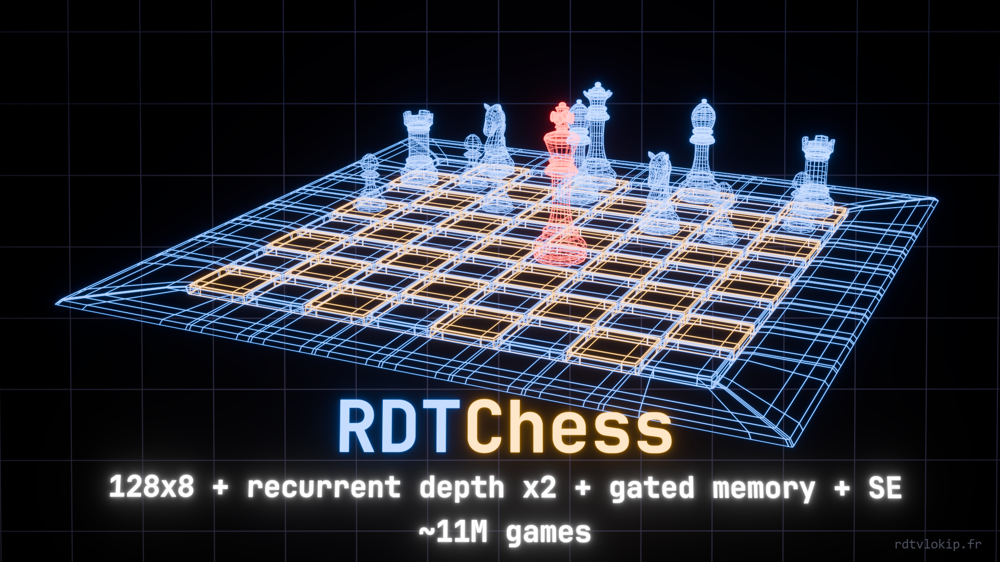
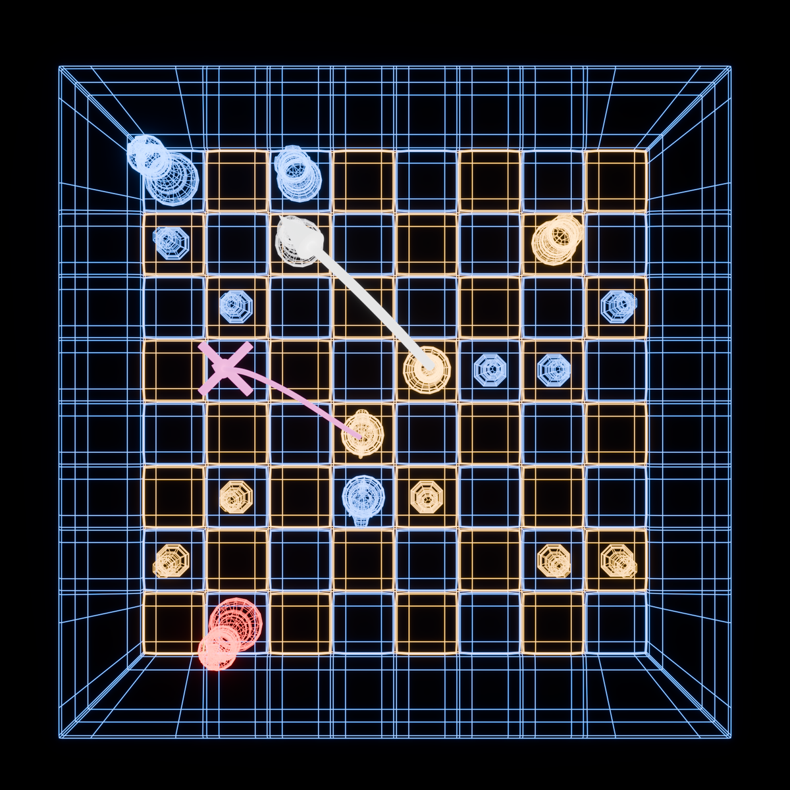

# ♟️ RDTChess3 — it imagines before it plays



**RDTChess3** is RDTChess2 (**11.05M** parameters, recurrent depth ×2, gated memory, SE) after a short self-distillation, plus a **3.84M-parameter look-ahead module *g*** that predicts the network's own latent state *after* a move, without playing the move on a board. When the policy hesitates (top move under 60 %), it **imagines its three best moves** and lets its own value head judge them. **No tree search, no engine labels, human games only.** ≈ **+100 Elo over RDTChess2** (63.96 % on 4,000 openings kept untouched until the model was fixed). Live on the [Lichess bot](https://lichess.org/@/RDTChessBot). Full report: [doi.org/10.5281/zenodo.24295060](https://doi.org/10.5281/zenodo.24295060).

[](https://lichess.org/@/RDTChessBot)
[](https://huggingface.co/RDTvlokip/RDTChess)
[](https://doi.org/10.5281/zenodo.24295060)

-4C6EF5?style=flat-square)


> ⚠️ **One network, one training run.** Every RDTChess3 number below comes from a single network and a single training run; the comparisons are paired and their intervals are over openings, not over training seeds. The full protocol, every control and every limit are in the [technical report](https://doi.org/10.5281/zenodo.24295060).

This repository holds the **inference code**. The weights live on [Hugging Face](https://huggingface.co/RDTvlokip/RDTChess) — **three** checkpoints: `RDTChess3.pt` (this page's main subject, live on Lichess), `RDTChess2.pt`, its base, described in [📎 RDTChess2](#rdtchess2), and `RDTChess.pt`, the original plain network, in [📎 RDTChess (original)](#rdtchess).

---

## 🧩 Identity

| | |
|---|---|
| **Base network** | RDTChess2 architecture: residual tower **128 channels × 8 blocks**, recurrence ×2, gated, SE, policy + value heads — weights after self-distillation |
| **Look-ahead module *g*** | 12 residual blocks of 128 channels; input = latent state *h* + the move (two one-hot planes); output = the imagined latent state of the next position |
| **Parameters** | **14.9 M** = 11.05 M (network) + 3.84 M (*g*) |
| **Input / outputs** | Same as RDTChess2: 19 planes of 8×8 in the canonical frame; 4096 policy logits; one value in [−1, 1] |
| **Search** | **None** — at most three imagined positions per move, compared once; nothing is played on a board to choose the move |
| **Training data** | The same Lichess games as RDTChess2 (July 2026, both players ≥ 1800); **no engine label anywhere** |
| **Extra training** | Self-distillation 45 min; *g* 51,408 steps (≈ 13 h); about 15 h of GPU in total on top of RDTChess2, same GTX 1080 Ti |
| **Time per move** | ≈ 9.6 ms on a GTX 1080 Ti, ≈ 29 ms on one CPU thread (as on the bot) — RDTChess2: 7.4 / 15 ms |

### How it imagines

The network computes the latent state *h* of the position once. If its favourite move has a probability of at least 0.60, it plays it. Otherwise it takes its **three most likely moves** *c*₁, *c*₂, *c*₃, imagines each resulting position with *g*, and plays

```
argmax_k   -v( g(h, c_k) )  +  0.02 · ln p(c_k)
```

In words: each candidate gets the score of its imagined position (the value is seen from the opponent's side, hence the minus sign), plus a small bonus if the policy liked it, so an unlikely move needs a clearly better imagined position to be chosen. About **59 %** of moves are re-read this way and **22 %** are changed. The threshold, *K* = 3 and β = 0.02 are stored in the checkpoint (`rule`).

The only hand-written rule is a safeguard shared with RDTChess2 (`FinishPlies: 1`): against a bare king, a mate in one is taken and a stalemate in one is refused.

**An example from its games** (Black to move, seen from Black's side; RDTChess3 has Black against Maia-3 at 1900):

<p align="center"></p>

**White arrow, the move it imagines and plays: Bf2** (d4 → f2). The policy gives it only 10.5 %, but the imagined position judges it best, and it saves the game. **Pink arrow, crossed out: the instinct move Ng4** (e5 → g4), the policy's first choice at 29 %, which loses at once to Rf8 mate. The position comes from the evaluation games of an earlier version; the released RDTChess3 makes the same choice.

## 🔨 How it was made

1. **Self-distillation (45 minutes).** RDTChess2 is fine-tuned to play directly the move its own value head prefers after a one-ply re-reading of the positions where it hesitates, while still learning the human move and the game result. A control fine-tuning without this loss scores 50.11 % against RDTChess2, so the gain is not the extra training itself.
2. **The look-ahead module *g*.** With the network frozen, *g* learns to turn (latent state, move) into the latent state the network would compute on the real resulting position. Its loss asks the imagined position to look like the real one, get the same score from the value head, put sibling moves in the same order, and be read the same way by the policy head. *g* starts by predicting "nothing changes" (zero-initialised output) and was trained for 51,408 steps on the training games.
3. **The rule above**, applied at play time only.

That is the whole method: no self-play, no MCTS, no engine as a teacher, no opening book, no tablebase.

---

## 📊 Evaluation

**The three versions side by side** (same benchmarks for all three; duels: 8,000 games each, both colours on openings 0–3,999, no search on either side; Maia: 300 games per match, same openings for the three versions; puzzles: whole solution, 5,000 puzzles; human matching: 25,000 positions of September 2026 games):

| | RDTChess (original) | RDTChess2 | **RDTChess3** |
|---|:-:|:-:|:-:|
| Network | 128×8, plain | 128×8 + recurrence ×2 + gated memory + SE | RDTChess2 + self-distillation + look-ahead *g* |
| Parameters | 10.92M | 11.05M | 11.05M + 3.84M (*g*) |
| Duel against the original | — | 57.23 % (≈ +51 Elo) | **72.68 %** (≈ **+170 Elo**) |
| Duel against RDTChess2 | — | — | **64.22 %** (≈ **+102 Elo**) |
| Maia-1 1100 / 1500 / 1900 | 75.3 / 61.3 / 56.3 | 78.5 / 69.7 / 60.5 | **86.0 / 80.0 / 80.5** |
| Maia-2 1100 / 1500 / 1900 | 64.3 / 52.2 / 41.7 | 66.0 / 64.2 / 54.0 | **80.8 / 69.3 / 66.8** |
| Maia-3 1100 / 1500 / 1900 | 67.0 / 50.0 / 30.3 | 71.7 / 56.2 / 38.3 | **82.3 / 68.8 / 50.8** |
| Minimax depth 2 (`versus.py`, 300 games) | 63.0 % (+155 =68 −77) | 64.8 % (+137 =115 −48) | **86.8 %** (+234 =53 −13) |
| Puzzles 1000 / 1800 / 2600 | 72.4 / 32.7 / 8.1 | 77.3 / 37.9 / 9.0 | **83.5 / 48.8 / 10.8** |
| Puzzles, all | 35.82 % | 40.08 % | **46.52 %** |
| Same move as the human | 50.76 % | **51.44 %** | 47.63 % |
| Puzzle first move, all (23,845 puzzles) | 57.77 % | 61.48 % | **66.01 %** |
| First move **quiet**: all / 2000–2399 / **2400+** | 53.1 / 39.3 / 32.8 | 55.4 / 42.0 / 33.3 | **61.4 / 47.1 / 41.5** |
| First move a capture: all / 2400+ | 66.5 / 56.1 | 69.4 / 59.9 | **70.4** / 59.5 |
| First move a check: all / 2400+ | 56.7 / 51.4 | 61.5 / 55.3 | **66.6 / 57.5** |

Each version is stronger than the one before; RDTChess3 is the first to copy humans *less* (it chooses what wins when it hesitates). Elo values are differences from paired duels, not ratings.

**The quiet move was the weak point of the first two versions** (33 % of strong quiet first moves found at 2400+, more than 20 points below captures). RDTChess3 raises it to **41.5 %** (+8.2): about half from the self-distillation alone, half from the imagination; on captures it gains almost nothing.

**Paired duels against RDTChess2** (8,000 games per cell, both colours on each opening; 95 % bootstrap intervals over openings):

| Player | Openings 0–3,999 | 4,000–7,999 | 12,000–15,999 (untouched) |
|---|:-:|:-:|:-:|
| Imagination only (RDTChess2 + rule + *g*) | 55.24 % | 56.43 % | — |
| Self-distillation only (policy alone) | 55.96 % | 55.85 % | — |
| **RDTChess3** (both) | **64.22 %** | **64.85 %** | **63.96 %** [63.09, 64.82] |

The two mechanisms add up: each alone gives ≈ +40 Elo, together ≈ +100. The untouched set was played once, after the model was fixed.

**Against Maia** (CSSLab's human-imitating models, one move per position, no search on either side; 300 games per match unless stated):

| Opponent | RDTChess2 | RDTChess3 | Paired gap |
|---|:-:|:-:|:-:|
| Maia-1 1100 / 1500 / 1900 | 78.5 / 69.7 / 60.5 | **86.0 / 80.0 / 80.5** | +7.5 / +10.3 / +20.0 |
| Maia-2 1100 / 1500 / 1900 | 66.0 / 64.2 / 54.0 | **80.8 / 69.3 / 66.8** | +14.8 / +5.2 / +12.8 |
| Maia-3 (23M) 1100 / 1500 / 1900 | 71.7 / 56.2 / 38.3 | **82.3 / 68.8 / 50.8** | +10.7 / +12.7 / +12.5 |
| Maia-1 1900, 2,000 games | 62.0 | **76.2** | +14.3 [+12.0, +16.5] |
| Maia-3 1900, 1,000 games | 37.6 | **51.2** [48.6, 53.9] — level | +13.6 [+10.2, +17.1] |
| Maia-3 2200 / 2600 | 22.5 / 16.8 | 34.0 / 27.3 | +11.5 / +10.5 |

RDTChess3 is above RDTChess2 in all nine matches (pooled paired gap +11.8 [+9.9, +13.8] points), level with Maia-3 at its 1900 setting, and **clearly beaten** by Maia-3 at 2200 and 2600.

**Puzzles and human move matching** (puzzles: whole solution, 1,000 puzzles per rating band; human matching: 25,000 positions of September 2026 games):

| Player | Puzzles 1000 | 1800 | 2600 | All | Same move as the human |
|---|:-:|:-:|:-:|:-:|:-:|
| RDTChess2 | 77.3 | 37.9 | 9.0 | 40.08 | **51.44** |
| **RDTChess3** | **83.5** | **48.8** | **10.8** | **46.52** | 47.63 |
| Maia-3 (23M) | 93.0 | 64.0 | 17.6 | 59.16 | 57.40 |

**It plays stronger and less like a human:** when it hesitates, it now picks what wins more often, not what a human would play.

> 🚫 **No absolute Elo is claimed.** "≈ +100 Elo" is a difference against RDTChess2, from paired duels. Re-reading the *real* resulting positions with the same rule is still stronger (73.35 % against RDTChess2): the imagination captures a little under half (45 % [33, 57]) of that gain.

---

## Play it right now

The model runs live as a Lichess bot: **[lichess.org/@/RDTChessBot](https://lichess.org/@/RDTChessBot)**

Challenge it in bullet, blitz, rapid or classical, casual or rated. Correspondence is declined on purpose. **The bot runs `RDTChess3.pt`**, through `uci.py`, with `FinishPlies: 1` and one CPU thread per game.

## Run it yourself

```bash
git clone https://github.com/RDTvlokip/RDTChess
cd RDTChess
pip install -r requirements.txt

# the weights are not in this repo; pull the ones you want from Hugging Face
curl -L -o RDTChess3.pt https://huggingface.co/RDTvlokip/RDTChess/resolve/main/RDTChess3.pt
curl -L -o RDTChess2.pt https://huggingface.co/RDTvlokip/RDTChess/resolve/main/RDTChess2.pt
curl -L -o RDTChess.pt https://huggingface.co/RDTvlokip/RDTChess/resolve/main/RDTChess.pt
```

### Pick a move

```bash
python predict.py                                         # initial position, RDTChess3
python predict.py "6k1/5ppp/8/8/8/8/5PPP/R5K1 w - - 0 1"  # any FEN
python predict.py "" RDTChess2.pt                         # any checkpoint
```

```
top 5 moves
  e4        49.0 %
  d4        29.0 %
  Nf3        5.3 %
  ...
policy alone plays: e4
RDTChess3 plays:    e4   (imagined its 3 best moves)
```

### Play it in your browser

```bash
python play.py                        # RDTChess3, you are White, opens http://localhost:8000
python play.py --black
python play.py --model RDTChess2.pt   # or RDTChess.pt
```

Three modes in the page — play the model, play the minimax, or watch the two of them — plus a depth slider. Standard-library HTTP server, no build step, no CDN.

### As a UCI engine

```bash
python uci.py                         # RDTChess3 (default)
python uci.py --model RDTChess2.pt
```

Speaks UCI, so it plugs into any interface or into [lichess-bot](https://github.com/lichess-bot-devs/lichess-bot). It reports depth 1 and ignores every time-control parameter: there is no search to budget. Each `info` line says whether the move was played by instinct or after imagining three moves.

### In your own code

```python
import chess
from engine import ChessEngine
from imagination import ImaginationPlayer

player = ImaginationPlayer("RDTChess3.pt", device="cpu", finish_plies=1)
board = chess.Board()
move = player.get_move(ChessEngine(board.copy()))
print(board.san(move), "imagined" if player.last_imagined else "instinct")
```

`ImaginationPlayer` loads the network, *g* and the rule from the checkpoint. For the raw network only (one forward pass), see [📎 RDTChess2](#rdtchess2); `ChessNetwork.from_checkpoint("RDTChess3.pt")` works the same way.

⚠️ **The one mistake to avoid**: reading `argmax` over the full 4096 logits. The policy was only ever trained on legal moves; its illegal logits are meaningless. Always gather at `legal_move_indices` first.

---

## Limits — read these before quoting any number

- **It does not beat Stockfish**, not even remotely. It is a small network with a one-ply imagination, not an engine.
- **It plays less like a human than RDTChess2** (47.63 % vs 51.44 % of human moves): when it hesitates, it picks what wins more often, not what a human would play.
- **Re-reading the real positions is still stronger** than imagining them; the imagination captures a little under half of that gain.
- **One network, one training run** for every RDTChess3 number; the recipe was confirmed on a smaller network with three seeds (≈ +62 Elo), not on this one.
- **Maia-3 is clearly stronger at its 2200 and 2600 settings**, and better at predicting human moves.
- **Under-promotions cannot be represented** (as in RDTChess2): promotions always decode to a queen.
- **No absolute rating.** Lichess ratings measure strength against the bots and humans the account meets, not against humans in general.

---

## What is in this repository

| file | role |
|---|---|
| `network.py` | the architecture — loads any of the three checkpoints, config comes from the file |
| `imagination.py` | *g* and the RDTChess3 player (inference only) |
| `encoding.py` | board ↔ tensor, move ↔ index |
| `player.py` | the network as a player, `get_move(engine)` |
| `engine.py` | board wrapper, canonical encoding, hand-written evaluation |
| `algo_player.py` | alpha-beta minimax, the opponent used in early evaluation |
| `gui.py`, `play.py` | the browser board |
| `uci.py` | UCI engine, the one the Lichess bot runs |
| `predict.py` | one-position example |
| `puzzles.py` | the puzzle grid, sampled by cell and paired across models |
| `versus.py` | score against the minimax, with its standard error |
| `opening_book.py` | the short opening book `versus.py` uses on the model's first moves |
| `round_robin.py` | model against model, paired random openings |

**Inference only.** The training code is not part of this repository. `imagination.py` reproduces, move for move, the player measured in the report.

---

<a id="rdtchess2"></a>
## 📎 RDTChess2

Everything in this section is about `RDTChess2.pt`: the base of RDTChess3, with no self-distillation and no imagination — one forward pass per move. It was the model live on the Lichess bot until RDTChess3. Its numbers come from a single training run on a single seed (123).

### Identity

| | |
|---|---|
| **Architecture** | Residual tower, **128 channels × 8 blocks**, recurrence ×2, gated, SE, two heads |
| **Parameters** | 11.05 M |
| **Input** | 19 planes of 8×8, canonical frame |
| **Policy output** | 4096 raw logits (from-square × 64 + to-square) |
| **Value output** | one scalar in [−1, 1], `tanh` |
| **Search** | **none** — one forward pass per move |
| **Training data** | ≈10.99 M Lichess games, both players ≥ 1800 Elo (8 sequential slices, one seed carried through with `--resume`) |
| **Positions seen** | 801,295,726, summed across the 8 slices |
| **Training time** | 68.6 h total on a GTX 1080 Ti, across the 8 sequential runs |

This is `RDTChess2.pt`. `RDTChess.pt` — the plain architecture on its own, no recurrence, no gate, no SE — has its own Identity/Evaluation/Data-scaling numbers in [📎 RDTChess (original)](#rdtchess) near the end of this page.

#### The encoding, and why it is shaped this way

Everything lives in a **canonical frame**: the side to move is always "White, playing up the board". When Black is to move, every square is mirrored (`square ^ 56`) and the piece colours swap.

Two consequences, both deliberate:

- the value head always answers **"how good is this for the player to move"**, which is a well-defined question — unlike an absolute encoding, which does not even tell the network whose turn it is;
- a position and its colour-reversed twin share one representation, so every game trains both colours at once.

The 19 planes: 12 for pieces (6 ours, 6 theirs), 4 castling rights, 1 en passant, 1 fifty-move counter, 1 repetition flag.

The policy head emits **logits, not a softmax**. That is what lets the caller mask illegal moves *before* normalising. Softmaxing over all 4096 actions and then zeroing ~99 % of them spends most of the model's capacity learning that illegal moves are illegal — capacity this size cannot spare.

### How it was made

**Architecture.** Same 128×8 residual tower as `RDTChess.pt`, plus three additions applied together:

- **Recurrent depth ×2** — the tower is applied twice per move, sharing the same convolution weights both times (effective depth ×2 at no extra parameter cost for the convolutions themselves).
- **Gated shortcut** — a learned per-channel, per-square gate decides how much of the previous pass to keep versus overwrite (`z = sigmoid(W[candidate; previous])`, initialised at `sigmoid(-2) ≈ 0.12` so ~88 % of the previous state survives each pass by default).
- **Squeeze-and-Excitation** in every residual block — a per-channel scale and bias computed from the whole board at once, buying long-range interaction (e.g. a1–h8) without extra convolutional depth.

**Data.** The Lichess July 2026 standard-game dump, split into 8 sequential slices of ≈1.37M games each (both players rated ≥ 1800). One seed (123) trained on the first slice, then carried through the other 7 with `--resume`, so the final checkpoint has seen all ≈10.99M games and 801,295,726 positions, one epoch each.

**Objective.** Plain behaviour cloning. The policy is cross-entropy against the move the human actually played, computed over the legal moves only. The value head regresses the final game result, expressed from the side to move.

**Recipe.** AdamW, learning rate 1e-3, weight decay 1e-4, betas (0.9, 0.999), batch size 512, gradient clipping 1.0, one epoch per slice, no learning-rate schedule.

That is the whole method. No self-play, no MCTS, no distillation from an engine, no opening book, no endgame tablebase.

### Evaluation

**Compared against the plain (non-recurrent, non-gated, non-SE) 128×8 architecture, same data, same seed, one run each time — puzzles, Maia and minimax across all 8 slices; the round-robin across the first 7, run before the 8th finished training:**

| yardstick | result |
|---|---|
| Puzzles, first move (McNemar, 23,845 puzzles) — single forward pass, no search | **ahead 8 / 8** — never inverted, always significant |
| Maia-1100 / 1500 / 1900, no search either side — 300 games per slice per level | **ahead 23 / 24** — one isolated reversal, recovered next slice |
| Full round-robin, 14 checkpoints, 91 pairs, 27,300 games, no search either side | **ahead 7 / 7** — never inverted, the most stable instrument of all four |
| Minimax depth 2 (n=300) — an adversary that searches, unlike the three above | ahead 4 / 8 — no stable direction, each swing confirmed on a second independent draw |

> 🚫 **No absolute Elo is claimed.** This model has never been played against a rated pool. Every figure here is a *difference* measured inside one family of models, on one training seed.

**Actual scores against Maia** (CSSLab's human-imitating engine, `nodes=1`, no search either side), on the final checkpoint — one training seed (123):

| Opponent | RDTChess2.pt | Plain architecture |
|---|---|---|
| Maia-1100 | **78.5 %** | 77.3 % |
| Maia-1500 | **69.7 %** | 68.8 % |
| Maia-1900 | **60.5 %** | 55.8 % |

**Read this precisely, not optimistically.** Puzzles, Maia, and the round-robin all judge in **one pass, no search** — the same regime this model is actually deployed in — and all three are stable and one-sided across every slice tested. Minimax is a stress test against an opponent that searches for a refutation; the mechanism never collapses against it, but the signal is too noisy at n=300 to claim it wins there either. On the 5 hand-picked positions where the production model actually lost a real game, both architectures bounce between fixing and re-breaking the same handful of positions slice to slice — until, on the very last slice, both converged on choosing the exact identical move on all 6 tested, the first time that happened.

This was confirmed on **one seed (123) only**, extended sequentially across 8 slices of the same data with `--resume`. The 1.38M-game starting point was separately confirmed on three independent seeds (24, 123, 454) before this single-seed extension began; the extension itself has not been repeated on another seed.

### What it is good at, and where it breaks

Measured on the same **23,845 Lichess puzzles** as the comparison above, on the final checkpoint (all 8 slices). One move per position, no search.

| | |
|---|---|
| first move of the solution | **61.5 %** |
| entire line | **42.5 %** |
| random baseline | 3.6 % (28.0 legal moves on average) |

#### The entry move is the hard one

The network is asked at **every** move of the line — even after it has already erred, so that no step is measured on a pre-filtered sample.

| length | accuracy, first move → last |
|---|---|
| 2 moves | 54.5 → **78.3** |
| 3 moves | 56.9 → 71.1 → **87.0** |
| 4 moves | 64.1 → 72.7 → 77.7 → **89.6** |
| 5 moves | 68.7 → 75.5 → 77.6 → 83.0 → **91.7** |

**The entry is the hardest move of every line here too, by 10 to 22 points — a smaller gap than `RDTChess.pt`'s 20 to 35, but not closed.** The last move of the line sits around 90 %, same as the original architecture.

#### And it is the *quiet* entry that breaks, same as the original

First move found, split by what kind of move it is.

| entry move | <1200 | 1200-1599 | 1600-1999 | 2000-2399 | 2400+ |
|---|---|---|---|---|---|
| check | 79.7 | 65.2 | 52.6 | 42.0 | 55.3 |
| capture | 92.2 | 77.4 | 63.8 | 60.7 | **59.9** |
| quiet | **95.1** | 80.3 | 59.1 | 42.0 | **33.3** |

The quiet move is still the hardest category at high rating — 33.3 % at 2400+, essentially unchanged from `RDTChess.pt`'s 32.8 %. Every band improved a little (quiet at 1600-1999: 59.1 vs 54.7; at 2000-2399: 42.0 vs 39.3), but the *shape* — quiet collapsing from easiest to hardest as rating rises — is identical. Recurrent depth, gating and SE bought accuracy; they did not change what kind of move the network struggles to initiate.

### Use the raw network (one forward pass)

RDTChess2 is played by `python play.py --model RDTChess2.pt`, `python uci.py --model RDTChess2.pt` or `python predict.py "" RDTChess2.pt`. In your own code:

```python
import chess, numpy as np, torch
from encoding import board_to_planes, legal_move_indices
from network import ChessNetwork

model = ChessNetwork.from_checkpoint("RDTChess2.pt", device="cpu")  # or "RDTChess.pt", "RDTChess3.pt"
board = chess.Board()

moves, indices = legal_move_indices(board)          # legal moves + their indices
planes = torch.from_numpy(board_to_planes(board)).unsqueeze(0)

with torch.no_grad():
    logits, value = model(planes)

legal = logits[0, torch.as_tensor(indices.astype(np.int64))]
probs = torch.softmax(legal.float(), dim=0).numpy()  # over legal moves ONLY
print(board.san(moves[int(probs.argmax())]), float(value))
```

⚠️ **The one mistake to avoid**: reading `argmax` over the full 4096 logits. About 99 % of them are illegal in any given position. Always gather at `legal_move_indices` first.

`ChessNetwork.from_checkpoint` returns the model already in `eval()` mode. Keep it there — the tower is BatchNorm, and train-mode batch statistics will corrupt single-position inference.

### Limits of RDTChess2

- **It imitates, it does not solve.** The objective is agreement with 1800+ humans. Where those humans are systematically wrong, so is the model, by construction. It is not trying to find the best move; it is trying to find the *likely* move.
- **No search, and it shows.** One forward pass. The puzzle breakdown in the RDTChess (original) section locates the cost precisely: 90 % on forced continuations, 32.8 % on quiet entries in hard positions — the same weakness this architecture inherits, since neither addition changes what the model is asked to do.
- **One seed, one run.** No variance control on the extension past 1.38M games (the 1.38M starting point itself was 3-seed confirmed).
- **Under-promotions cannot be represented.** The action space collapses from/to pairs and always decodes promotions to a queen. This costs well under 0.1 % of moves in normal play, but it makes a handful of knight-promotion puzzles unsolvable *by construction*.
- **No absolute rating.** Its Lichess ratings while it ran the bot (16 November 2026: bullet 1,707, blitz 1,476, rapid 1,496, classical 1,762) measure strength against the bots and humans that account met, not against humans in general. Do not read a win-rate against minimax as an Elo.
- **The value head is weak supervision.** It regresses the final result of the game, which is a very noisy label for a position at move 12.
- **Distribution.** Trained on rated blitz/rapid from one month of one server, at one rating floor. Behaviour outside that distribution — correspondence, odds games, composed positions — is untested.
- **The released weights are the raw supervised checkpoint.** No self-play fine-tuning was applied to it (RDTChess3's self-distillation starts from it).
- **The minimax comparison is noisy at n=300.** Read the round-robin (91 pairs, 27,300 games) as the more direct instrument; minimax swings by double digits between two independent draws.

---

## Reproduce the measurements

The tools that produced the RDTChess2 and RDTChess numbers on this page are here. They are the
methodological part of the project, and the part worth reusing. Pass any
checkpoint's filename — the examples below use `RDTChess2.pt`, and every one of
them works identically on `RDTChess.pt`. They measure the **network alone** (one
forward pass); on `RDTChess3.pt` they measure its network without the
imagination. The RDTChess3 player itself is measured in the
[report](https://doi.org/10.5281/zenodo.24295060).

### The puzzle grid

```bash
curl -L -O https://database.lichess.org/lichess_db_puzzle.csv.zst   # 290 MB
pip install zstandard
python puzzles.py RDTChess2.pt
```

23,845 puzzles sampled **per cell of (solution length × rating band)**, because
the two are confounded: a mate-in-3 is rated higher than a mate-in-1, so
"accuracy falls with length" would otherwise just restate "hard puzzles are
hard".

Lines are **forced**: the network is queried at every move of the solution even
after it has already erred. Without that, accuracy at move *k* would only be
measured on puzzles whose first *k−1* moves were already found — a sample sorted
by construction, where "the network composes" cannot be told apart from "the
surviving puzzles were the easy ones".

The first run writes its sample to `logs/puzzle_sample.csv` and every later run
reuses it, so two models are compared on the same positions and the test is
paired.

### Against the minimax

```bash
python versus.py RDTChess2.pt --games 300 --depth 2
```

Judge on **depth 2**. Depth 1 saturates for a trained model: `RDTChess.pt`
scored 88.7 % against depth 1 and 59.5 % against depth 2, twenty-nine points
apart for the same model. It prints the standard error, because a two-point gap
on 300 games is not measurable.

The protocol is the one that produced those figures: on its first 8 plies the
model plays from a short opening book, then **draws** its move from the policy;
after that it plays normally (`RDTChess3.pt` with its imagination); games stop at
200 plies. Without the draw, both sides are deterministic and the same few games
repeat. The minimax's ties are seeded per game, so a run is reproducible; the
original figures came from an unseeded run and match only within the standard
error.

### Model against model

```bash
python round_robin.py 300 RDTChess2.pt RDTChess.pt
```

Two greedy networks are two deterministic functions: from the initial position
they replay **the same game** forever. So 8 random legal plies are drawn before
handing control back, and each opening is played in **both colour directions** —
otherwise you compare two different samples and the first-move advantage
(measured at 52.8 % over 3600 games) mixes with the luck of the draw.

Sanity check that the pairing is symmetric: run a model against a copy of
itself and the score is exactly 50.0 %.

---

<a id="rdtchess"></a>
## 📎 RDTChess (original)

Everything in this section is about `RDTChess.pt` specifically: the plain 128×8 tower, no recurrence, no gate, no SE — the original single-seed, 5.5M-game run. None of the numbers below apply to `RDTChess2.pt` or `RDTChess3.pt` above; RDTChess2's own comparison against this architecture is in [📎 RDTChess2](#rdtchess2).

### Identity

| | |
|---|---|
| **Architecture** | residual tower, **128 channels × 8 blocks**, two heads |
| **Parameters** | 10.92 M |
| **Input** | 19 planes of 8×8, canonical frame |
| **Policy output** | 4096 raw logits (from-square × 64 + to-square) |
| **Value output** | one scalar in [−1, 1], `tanh` |
| **Search** | **none** — one forward pass per move |
| **Training data** | 5,497,103 Lichess games, both players ≥ 1800 Elo |
| **Positions seen** | 400,581,531, one epoch |
| **Training time** | 12 h 54 on a GTX 1080 Ti |

### How it was made

**Data.** The Lichess July 2026 standard-game dump. A game is kept when **both** players are rated ≥ 1800 (the filter takes `min(WhiteElo, BlackElo)`), which leaves 5,497,103 games in the 5 GB archive — all of them used. Every position of every kept game becomes one training sample, from the first ply: 400,581,531 positions, seen once.

**Objective.** Plain behaviour cloning. The policy is cross-entropy against the move the human actually played, computed over the legal moves only. The value head regresses the final game result, expressed from the side to move.

**Recipe.** AdamW, learning rate 1e-3, weight decay 1e-4, betas (0.9, 0.999), batch size 512, gradient clipping 1.0, one epoch, no learning-rate schedule.

That is the whole method. No self-play, no MCTS, no distillation from an engine, no opening book, no endgame tablebase.

### Evaluation

Three independent yardsticks, because they disagree — and the disagreement is itself a finding.

| yardstick | result | detail |
|---|---|---|
| **Top-1 on held-out human moves** | **51.7 %** | agreement with what the human actually played |
| **vs minimax depth 1** | **88.7 %** | 300 games · +249 =34 −17 |
| **vs minimax depth 2** | **59.5 %** | 300 games · +144 =69 −87 |
| **vs the same net trained on 2M games** | **55.1 %** | 600 games · +35 Elo · p = 0.0034 |

A fixed opponent measures *how well you exploit that opponent*, not general strength: the depth-1 and depth-2 figures move by 29 points for the same model. The head-to-head duel is the most informative of the three.

> 🚫 **No absolute Elo is claimed.** Every Elo figure here is a *difference* measured inside one family of models. The [Lichess bot](https://lichess.org/@/RDTChessBot) never ran this architecture (it ran `RDTChess2.pt`, then `RDTChess3.pt`).

#### Data scaling

| games | net | decade | gain vs d1 | rate |
|---|---|---|---|---|
| 150 k → 1 M | 96×4 | 0.82 | +21.2 pts | 25.7 / decade |
| 1 M → 2 M | 96×4 | 0.30 | +6.3 pts | 20.9 / decade |
| **2 M → 5.5 M** | **128×8** | 0.44 | **+8.0 pts** | **18.2 / decade** |

The rate bends steadily — 25.7, 20.9, 18.2 — without collapsing. The +8.0 was **predicted at +9 before the run** from the two earlier points.

The last row is a wider net than the first two, so the three rates are **not** a single controlled curve: read the bend as a trend, not as a measurement.

### What it is good at, and where it breaks

Measured on **23,845 Lichess puzzles**, sampled by cell (solution length × rating band) so that puzzle difficulty is not confounded with solution length. One move per position, no search.

| | |
|---|---|
| first move of the solution | **57.8 %** |
| entire line | **38.3 %** |
| random baseline | 3.6 % (28.0 legal moves on average) |

#### The entry move is the hard one

The network is asked at **every** move of the line — even after it has already erred, so that no step is measured on a pre-filtered sample.

| length | accuracy, first move → last |
|---|---|
| 2 moves | 51.9 → **76.1** |
| 3 moves | 53.6 → 67.5 → **85.1** |
| 4 moves | 60.4 → 69.6 → 75.2 → **88.0** |
| 5 moves | 65.5 → 72.5 → 75.5 → 80.3 → **90.6** |

**The entry is the hardest move of every line, by 20 to 35 points. The last is around 90 %, whatever the depth.** Once inside a forcing sequence — recaptures, checks, the mate — the network barely errs. Starting one is the problem.

#### And it is the *quiet* entry that breaks

First move found, split by what kind of move it is.

| entry move | <1200 | 1200-1599 | 1600-1999 | 2000-2399 | 2400+ |
|---|---|---|---|---|---|
| check | 74.4 | 59.5 | 47.5 | 39.5 | 51.4 |
| capture | 91.6 | 73.8 | 60.7 | 57.7 | **56.1** |
| quiet | **94.6** | 75.6 | 54.7 | 39.3 | **32.8** |

The quiet move goes from the **easiest** category to the **hardest** — 23 points below captures in the same band — as difficulty rises. Captures and checks are visible in the position; a quiet preparatory move is justified only by what comes three plies later.

> 💡 **In one sentence: this network executes tactics, it does not initiate them.**

---

## License

Apache-2.0. See [LICENSE](LICENSE).

## Citation

For RDTChess3 (the look-ahead module and the self-distillation), please cite the report:

```bibtex
@techreport{charlet2026rdtchess3,
  author      = {Théo CHARLET},
  title       = {RDTChess3: Latent Look-Ahead. Imagining the Next Position Inside a Search-Free, Human-Trained Chess Network},
  institution = {Independent research},
  year        = {2026},
  month       = nov,
  doi         = {10.5281/zenodo.24295060},
  url         = {https://doi.org/10.5281/zenodo.24295060}
}
```

For the models and code in general:

```bibtex
@misc{charlet2026rdtchess,
  author = {Théo CHARLET},
  title  = {RDTChess: 128x8 chess policy and value networks trained on human Lichess games},
  year   = {2026},
  publisher = {Hugging Face},
  howpublished = {\url{https://huggingface.co/RDTvlokip/RDTChess}}
}
```

---

**Théo CHARLET**

<p>
TSSR Graduate (IT Systems &amp; Networks Technician) — AI/ML Specialization<br />
Creator of AG-BPE (Attention-Guided Byte-Pair Encoding)
</p>

[](https://www.linkedin.com/in/théo-charlet)
[](https://rdtvlokip.fr)
[](https://search.rdtvlokip.fr)

🚀 Seeking internship opportunities
